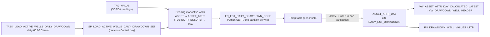

# Drawdown Management App — Functional Overview

**Author:** Chris Waters
**Accounts:** Adamas OPJQICB-DEV and OPJQICB-TEST · **App:** `CYGNET_TRANSFORMATION.APP.DRAWDOWN_MANAGEMENT_DAILY`
**Date:** October 2026
**Purpose:** Describe what the application does today, and how it uses the SCADA common model to estimate drawdown in Snowflake, so that reviewers can recommend how to extend it beyond drawdown surveillance.

---

## 1. Summary

The Drawdown Management app is a web application for production engineers who monitor tubing-pressure drawdown on Haynesville shale gas wells. It runs inside Snowflake on Snowflake App Runtime (a Next.js service with owner's rights) and reads everything from one database, `CYGNET_TRANSFORMATION`.

It has three parts:

1. **SCADA common model** (`CORE_COMMON_MODEL`). CygNet SCADA data is mapped into a generic asset / attribute / tag / value model, maintained by an upstream pipeline that is outside this project.
2. **Drawdown calculation** (`APP` functions, procedures and a task). A scheduled job reads tubing pressure from the common model, estimates a daily drawdown rate for each active well, and writes it back into the common model as a daily attribute.
3. **Application** (`APP` views and the web service). The app shows a well list with current conditions, multi-signal time-series charts, engineer notes and chart annotations, and well master attributes.

The app does not calculate anything itself. It reads the common model and the stored drawdown estimates through a small set of app-specific views and one table function. It writes only engineer commentary.

---

## 2. Users and workflow

The primary users are production engineers responsible for a set of wells. A typical session goes like this:

1. **Triage.** Open the well list, which is sorted by latest daily drawdown (highest first). Filter by county, state, well type, ProCount area or reservoir, or search by name. Sort by any column.
2. **Investigate.** Select a well to see its production history: gas rate, tubing and casing pressure, daily drawdown, choke positions, and water rate. The five charts are stacked, and zooming or panning one moves them all.
3. **Record.** Right-click a chart to annotate a point in time (for example "choke change", "shut-in"), or add free-text notes in the commentary panel. Notes have a category (Drawdown, Operations, Maintenance, General) and record the signed-in user as author.
4. **Context.** Check the well's fixed attributes (identifiers, location, well info, completion details) in the attributes panel.

There is no alerting, no workflow state such as acknowledged or assigned, and no write-back of setpoints or targets.

---

## 3. Application functionality

### 3.1 Screens and components

| Area | Component | What it shows / does |
|---|---|---|
| Well list | `components/drawdown-dashboard.tsx` | One row per well (multi-completion wells have one row per reservoir). Columns: Well, County, State, Type, Area, Reservoir, THP, CP, Gas Rate, Gas Yesterday, Drawdown, Choke. Client-side filters, search and sort. |
| Production history | `components/well-charts.tsx` | Five synchronised ECharts panels: **Gas Flow Rates** (rate, yesterday), **Pressures** (tubing, casing), **Drawdown** (daily estimate, psi/d), **Choke Positions** (choke output %, positive choke 64ths), **Water Flow Rates**. LTTB-downsampled to about 1,000 points per signal. Optional "value tracing" crosshair. Right-click to annotate. Annotations appear as pins coloured by category. |
| Commentary | `components/commentary-panel.tsx` | List, add, edit and delete notes for the selected well. |
| Well attributes | `components/well-attributes.tsx` | Asset ID, Enertia Completion ID, legal name, type, status, spud and rig-release dates, location, and completion attributes (reservoir, perf depths, working interest, Actenum area, frac dates). |

### 3.2 API routes and the Snowflake objects behind them

| Route | Methods | Reads / writes |
|---|---|---|
| `/api/drawdown-status` | GET | `APP.VW_DRAWDOWN_WELL_HEADER`: current state, one wide row per well |
| `/api/timeseries` | GET | `APP.FN_DRAWDOWN_WELL_VALUES_LTTB(start, end, well, points)`: downsampled long-format series (`WELL_ASSET_ID, ATTR_ID, TIMESTAMP_CENTRAL, VALUE_NUMBER`) |
| `/api/well-attributes` | GET | `APP.VW_DRAWDOWN_WELL_MASTER`, plus `ENERTIA_COMPLETION_ID` looked up from `CORE_COMMON_MODEL.VW_ASSET_ATTR` |
| `/api/commentary` | GET, POST, PUT, DELETE | `CORE_COMMON_MODEL.ASSET_COMMENTARY` (`RECORD_SOURCE = 'DRAWDOWN_APP'`) |
| `/api/chart-annotations` | GET, POST | `ASSET_COMMENTARY` rows whose `NOTE_JSON:signal` names the chart signal |

### 3.3 Signals in the app

The app is built around a fixed list of attribute IDs (common-model `ATTR_ID`s):

| Attribute | Source | Used in |
|---|---|---|
| `TUBING_PRESSURE`, `CASING_PRESSURE` | Well SCADA tags | List, Pressures chart, drawdown calculation (tubing only) |
| `CHOKE_OUTPUT`, `POSITIVE_CHOKE`, `ESD_STATUS` | Well SCADA tags | List (choke), Choke chart |
| `GAS_FLOW_RATE`, `GAS_FLOW_YESTERDAY` | Gas meter SCADA tags, mapped to the well | List, Gas chart |
| `WATER_FLOW_RATE`, `WATER_FLOW_YESTERDAY` | Water meter SCADA tags, mapped to the well | Water chart |
| `TARGET_DRAWDOWN_RATE`, `GAS_BUDGET`, `GAS_ADJ_BUDGET` | Attributes in the common model | Returned by the header view, not yet shown |
| `DAILY_EST_DRAWDOWN` | **Calculated** (Section 5), stored in `ASSET_ATTR_DAY` | List, Drawdown chart |

Adding a signal currently means editing the views (`PIVOT ... IN` lists and the attribute filters) and the chart configuration (`SIGNAL_CONFIG` in `well-charts.tsx`).

### 3.4 Security and runtime

- **Owner's rights.** Every query runs as `CYGNET_ADMIN` on `REPORTING_WH`. Users need USAGE on the database, the schema and the application service, and nothing on the data. See `drawdown-app-user-permissions.md`.
- **No row-level restriction.** Anyone who can open the app sees all wells and can edit any note. The author is captured from the signed-in user header.
- **Long-running queries.** The time-series function can take 10–20 seconds per well, so it is submitted asynchronously and polled. Results are cached in the browser per well for the session.

---

## 4. The SCADA common model as used here

`CORE_COMMON_MODEL` is an implementation of an IIoT common model populated from CygNet (`CORE_CYGNET` views). The app and the calculation use these parts of it:

| Object | Role |
|---|---|
| `ASSET` | Wells, meters and other equipment. `ASSET_TYPE_ID` (for example `WELL`), `STATUS` (`ACTIVE`), `BUSINESS_UNIT`. |
| `ATTR_DFNTN` | Attribute catalogue: business name, unit and category for each `ATTR_ID`. |
| `ASSET_ATTR` | Binds an asset and attribute either to a static value (for example `ENERTIA_COMPLETION_ID`) or to a SCADA `TAG_ID`. This is the main mapping layer. |
| `TAG` / `TAG_VALUE` | SCADA points and their time-series readings (about 835M rows, clustered on `DATE_UTC`). `TAG_VALUE_CURRENT` holds the latest reading per tag; `TAG_VALUE_DAY` holds daily first/last summaries. |
| `ASSET_ATTR_DAY` | **Daily attribute values per asset.** Calculated outputs such as `DAILY_EST_DRAWDOWN` are stored here with `VERSION_NUMBER` and `RECORD_SOURCE`. |
| `ASSET_COMMENTARY` | Free-text and structured (`NOTE_JSON`) notes per asset and time, written by the app. |
| `VW_ASSET_ATTR`, `VW_ASSET_ATTR_TAG_VALUE[_LATEST]`, `VW_ASSET_ATTR_DAY_CALCULATED_LATEST` | Contextual views that join assets, attribute definitions, tags and values into business-friendly rows. |

Two patterns matter for any extension:

- **Assets and attributes as data.** A new measurement only needs a new `ATTR_DFNTN` row and the `ASSET_ATTR` tag mappings; the schema doesn't change. The app-specific views are the only places that hard-code attribute lists.
- **Joining wells to meters.** Gas and water meters are separate assets. The drawdown tag-value views link them to wells by matching `ENERTIA_COMPLETION_ID`. Well master reference data comes from `EDW.ANALYTICS.DIM_WELL_COMPLETION_MASTER`, joined on the Enertia well code (`REGEXP_SUBSTR(ENERTIA_COMPLETION_ID, '^[^-]+')`).

The full dependency chain (24 objects across four layers) is in `adamas-active-dependencies.md`.

---

## 5. How drawdown is estimated in Snowflake

### 5.1 Definition

`DAILY_EST_DRAWDOWN` is the **daily rate of decline in flowing tubing pressure (psi/day)**, measured only during stable flow. A positive value means pressure is falling. It is a surface-pressure proxy for reservoir drawdown and is not a calculated bottomhole drawdown (for example via Hagedorn-Brown). The well's managed rate is compared against `TARGET_DRAWDOWN_RATE`.

### 5.2 Pipeline

| Object | Role |
|---|---|
| `TASK_LOAD_ACTIVE_WELLS_DAILY_DRAWDOWN` | Runs daily at 06:00 Central and calls the set-based procedure for the previous day. Its return value records wells, rows deleted and rows inserted. |
| `SP_LOAD_ACTIVE_WELLS_DAILY_DRAWDOWN_SET(start, end, chunk_days=90)` | Set-based loader for all active wells. For each chunk it scans `TAG_VALUE` once, reading 21 days before the chunk start through one day after the chunk end. It runs the core function partitioned by well and replaces that chunk's rows idempotently. Also used for backfills. |
| `FN_EST_DAILY_DRAWDOWN_CORE` | Python UDTF containing the estimation algorithm (5.3). |
| `SP_LOAD_WELL_DAILY_DRAWDOWN` / `FN_EST_DAILY_DRAWDOWN` | Single-well equivalents for ad-hoc reloads. `SP_LOAD_ACTIVE_WELLS_DAILY_DRAWDOWN` is the older per-well loop (too slow for about 1,700 wells). |

### 5.3 Stable-decline algorithm (`FN_EST_DAILY_DRAWDOWN_CORE`)

Surface tubing pressure on a flowing gas well is noisy, and it moves for many reasons that aren't reservoir depletion: choke changes, shut-ins, liquid loading, compressor or line-pressure upsets. The algorithm separates the steady flowing decline from those excursions:

1. **Hourly level.** Median tubing pressure per clock hour (Central). Hours with fewer than 3 samples are dropped.
2. **Rate band.** An hour is *normal* when its change from the previous hour falls within median ± max(4 × MAD, 3 psi) of the well's hourly changes over the previous 14 days. Because the band rolls, results don't depend on the requested date range.
3. **Excursions.** Abnormal hours within 6 hours of each other form one event. Hours are excluded from the start of the event until pressure either *recovers* (within 25 psi of the pre-event trend) or *rebases* (holds a normal rate for 12 hours, giving a new baseline). Exclusion then continues through a recovery tail of up to 72 hours, until the trailing 12-hour slope is back near the pre-event rate, plus 2 hours of settling.
4. **Clean runs.** Contiguous normal, non-excluded hours on the same day. Runs shorter than 4 hours, or rising faster than 0.5 psi/hr, are dropped.
5. **Daily level.** A Theil-Sen line through the day's clean hours, evaluated at 12:00. At least 10 clean hours are required.
6. **Daily delta.**
   - **LEVEL** method: yesterday's noon level minus today's, used only when no rebasing event falls between them.
   - **SLOPE** method (otherwise): −24 × the pooled within-run slope of today's clean runs, accepted only if its standard error is ≤ 10 psi/day.
   - If neither method is valid, the day is NULL and is not stored.

The function also returns `STABLE_AVG_TUBING_PRESSURE`, `STABLE_HOURS`, `STABLE_SAMPLE_COUNT`, `DELTA_METHOD` and `EXCLUDED_HOURS`. Today only the delta is stored. The other outputs are useful quality indicators that the app could show.

### 5.4 Serving to the app

- **Current value.** `VW_ASSET_ATTR_DAY_CALCULATED_LATEST` gives the most recent day's value for each well, which `VW_DRAWDOWN_WELL_HEADER` pivots alongside the latest SCADA values.
- **History.** `FN_DRAWDOWN_WELL_VALUES_LTTB` combines raw tag values (`VW_DRAWDOWN_WELL_TAG_VALUES`), daily summaries (`TAG_VALUE_DAY`) and daily drawdown. It then downsamples each well and attribute with Largest-Triangle-Three-Buckets, so the browser receives about 1,000 points per signal instead of hundreds of thousands. Drawdown is one point per day and isn't downsampled.

### 5.5 Known limitations

- Drawdown is a **surface** proxy. There is no bottomhole pressure, PVT or wellbore model.
- History on TEST starts 2026-06-01 and is sparse: about 270–400 wells per day, 721 wells in total. A backfill is planned.
- The algorithm's thresholds are global constants in the Python code, not per-well or per-field settings, and they aren't governed metadata.
- The `drawdown_daily` CTE in the LTTB function doesn't filter by well. The app applies the filter itself.

---

## 6. Design characteristics relevant to extension

| Characteristic | Current state | Implication for broader use |
|---|---|---|
| Domain focus | One use case (drawdown) with a fixed signal list | New surveillance use cases (liquid loading, plunger lift, artificial lift, compression, chemical injection, integrity) need new signals, charts and calculations. |
| Calculation pattern | Python UDTF over `TAG_VALUE` → `ASSET_ATTR_DAY`, scheduled by a task | The pattern can be reused for other daily KPIs, but each calculation is hand-wired: there is no registry of calculations, versions or parameters. The common model has empty `ATTR_CALC` / `ATTR_CALC_GROUP` tables meant for this. |
| Signal configuration | Hard-coded in the views (`PIVOT`) and in `SIGNAL_CONFIG` in the UI | A metadata-driven layout would let new signals appear without code changes. |
| Asset scope | Active wells only; meters reached through Enertia ID | Facility-, pad- or route-level views need `ASSET_HIERARCHY` (empty today) or another grouping. |
| Commentary | Free text plus a `NOTE_JSON` signal tag; no states | Could grow into events or exceptions (`ASSET_EVENT`, empty today), acknowledgements and links to work orders. |
| Targets | `TARGET_DRAWDOWN_RATE`, gas budgets are read but not shown or edited | Comparing against targets, flagging exceptions, and editing setpoints are natural next steps. |
| Access | Owner's rights, all wells visible to all users | Multi-team or multi-asset use may need business-unit or role scoping. |
| AI / agents | None | The app's data and commentary are the evidence an agent would need (Section 7). |

---

## 7. Relationship to the Unified Knowledge Graph design

`unified-knowledge-graph-design-standalone.md` proposes one governed knowledge graph in Snowflake, made up of domain vocabulary, enterprise semantics (measures, grain, time policy, authority, taxonomy) and engineering knowledge. Domain agents query the common model through semantic views, and a supervising agent applies engineering concepts only when a deterministic **evidence gate** confirms the evidence is present.

This app already fits that architecture in several places:

| Knowledge graph concept | Counterpart in this app |
|---|---|
| Common model keyed on well master | `CORE_COMMON_MODEL` plus `EDW.ANALYTICS.DIM_WELL_COMPLETION_MASTER` |
| Governed KPI calculation writing into the common model | `SP_LOAD_ACTIVE_WELLS_DAILY_DRAWDOWN_SET` → `ASSET_ATTR_DAY.DAILY_EST_DRAWDOWN` |
| `MEASURE` node (formula, unit, grain, source) | `DAILY_EST_DRAWDOWN`: psi/day, daily grain, Central day, tubing-pressure source, algorithm version. Not yet registered anywhere. |
| `TIME_POLICY` | The calculation uses the America/Chicago day. SCADA is stored in UTC. |
| Analytical apps that read from, and write commentary to, the common model | This app (`ASSET_COMMENTARY`) |
| Evidence bindings (`REQUIRED`, `DISCRIMINATING`, ...) | The signals in the charts: tubing and casing pressure, choke, gas and water rate, drawdown, and engineer annotations |
| SCADA domain agent | Would query the same attributes via a semantic view instead of the app views |

Possible directions in this context:

- **Register `DAILY_EST_DRAWDOWN` as a governed measure**, with its algorithm parameters and version, so that agents and other apps use one definition.
- **Expose the drawdown objects through a SCADA / production semantic view**, so a domain agent can answer "which wells are drawing down faster than target?" without the app.
- **Use the app as the human interface for diagnostic answers.** For example, show a supervisor's evidence-gated explanation of a drawdown change (choke change versus liquid loading versus reservoir) next to the chart, and store the engineer's confirmation as structured commentary.
- **Treat structured annotations as labelled evidence.** Annotations with a category, signal and time are candidate ground truth for evaluating diagnostic answers (design doc §9).

---

## 8. Questions for reviewers

Please use the sections above to recommend direction on the following. Where possible, separate what should change in the **app**, in the **calculation layer**, and in the **common model / knowledge graph**.

1. **Scope.** Which surveillance use cases should come next (for example liquid loading, plunger and artificial-lift performance, compression, water handling, integrity / casing pressure, production versus budget)? Should they live in this app or in sibling apps on shared components?
2. **Calculation framework.** Should calculations like `FN_EST_DAILY_DRAWDOWN_CORE` be generalised into a registry (`ATTR_CALC` / `ATTR_CALC_GROUP`) with versioned parameters, quality outputs and backfill tooling? What's the right granularity of tasks (one per KPI, or one per calculation group)?
3. **Metadata-driven UI.** Should signals, charts, units and axis ranges come from `ATTR_DFNTN` or knowledge graph metadata rather than code? What should the configuration model look like?
4. **Exceptions and workflow.** Should the app move from browsing to managing by exception: target comparison, exception lists, acknowledge / assign / resolve states, and links to work-management systems? Where should the state live (`ASSET_EVENT`, a new table, an external system)?
5. **Hierarchy and scale.** How should pad, facility, route, area and business-unit roll-ups be modelled (`ASSET_HIERARCHY`)? How should access be scoped by team or business unit?
6. **Data quality.** How should the app show data freshness, coverage and calculation quality (stable hours, method, excluded hours) so that engineers can trust a value or discount it?
7. **Agents and knowledge graph.** What is the smallest useful step toward the knowledge-graph architecture: a semantic view over these objects, registering drawdown as a measure, or embedding an agent in the app? How should engineer annotations feed evidence and evaluation?
8. **Bottomhole methods.** Should surface drawdown be complemented or replaced by bottomhole pressure estimates? What would that require from the common model (well geometry, PVT, completions)?
9. **Write-back.** Should engineers be able to edit targets and setpoints, or recommend choke changes, from the app? What controls and audit would that need?
10. **Operations.** What monitoring, data-latency expectations and SLAs (task runtime, backfill windows) are needed before broader roll-out?

---

## Appendix A. Repository references

| Path | Content |
|---|---|
| `app/` | Next.js application (`app.yml` v2 manifest) |
| `sql/01_tables` | `ASSET_ATTR_DAY`, `ASSET_COMMENTARY` |
| `sql/02_views` | Common-model contextual views and app drawdown views |
| `sql/03_functions` | `FN_DRAWDOWN_WELL_VALUES_LTTB`, `FN_EST_DAILY_DRAWDOWN[_CORE]` |
| `sql/04_procedures` | Daily drawdown loaders |
| `sql/05_tasks` | Daily drawdown task |
| `docs/adamas-active-dependencies.md` | Full object dependency map |
| `docs/drawdown-app-user-permissions.md` | End-user grants |
| `docs/unified-knowledge-graph-design-standalone.md` | Knowledge graph design proposal |
