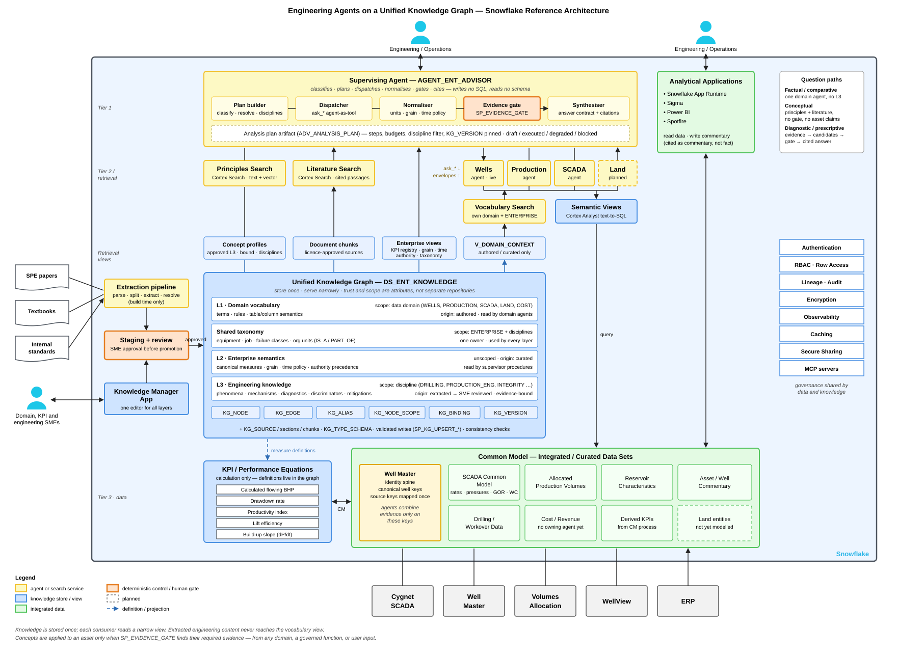
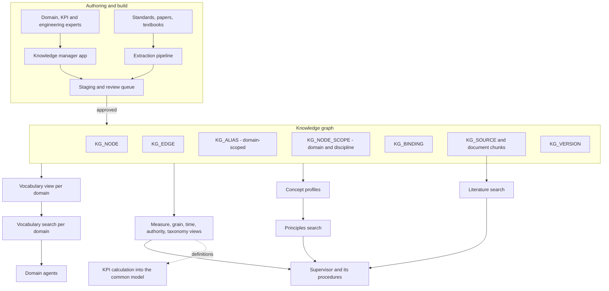
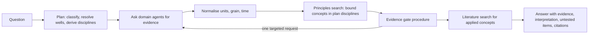

# A Unified Knowledge Graph for Engineering Agents

**Author:** Chris Waters
**Scope:** Knowledge foundation for AI agents answering upstream oil and gas questions in Snowflake
**Date:** September 2026
**Status:** Design proposal

------------------------------------------------------------------------

## 1. Introduction

This document describes how to store and serve the knowledge that AI agents need to answer engineering and operational questions for an upstream oil and gas operator. The design centres on one governed knowledge graph in Snowflake, with each agent reading from it through narrow, purpose-built views.

The document is intended to be read on its own. Section 2 describes the setting. Section 3 lays out the principles the design is built on. The remaining sections walk through the design itself, how it is used at query time, how it is maintained, and how it can be introduced alongside a working system without disrupting it.

------------------------------------------------------------------------

## 2. Setting

### 2.1 The questions people ask

Engineers and managers at an operator ask questions that range across several levels:

| Level | Example | What a good answer needs |
|-------|---------|--------------------------|
| Data | "Total non-productive time by trouble code in the district last quarter" | The right table, filters and grain |
| Domain analysis | "Which rigs have the worst NPT rate on intermediate sections?" | The above, plus correct measures and ranking |
| Diagnosis | "Why is intermediate-section NPT concentrated in this area?" | Data, plus engineering interpretation that the data supports |
| Decision | "What should we change in the next drilling programme?" | Several domains of evidence, interpretation and trade-offs |
| Reference | "How do you tell differential sticking from pack-off?" | Reliable engineering knowledge, cited |

The first two levels are primarily about finding and summarising data. The next two also require engineering judgement. The last draws only on engineering knowledge.

### 2.2 The data landscape

Operational data typically comes from several source systems: a drilling and well-operations system, production volume allocation, SCADA, a well master, and financial systems. We assume these are already integrated in Snowflake into a **common model**. This is a set of curated data sets joined on shared keys, where the well master supplies the canonical well identity. Engineering calculations such as flowing bottom-hole pressure, drawdown and productivity index are computed into the common model by a governed process, and their definitions are kept in a KPI repository.

The common model is exposed to agents through **semantic views**, which describe tables, columns, relationships and measures in business terms so that a text-to-SQL service (Cortex Analyst) can query them.

### 2.3 The agents

The agent design has two levels:

- **Domain agents**, one per data domain (for example wells, production, SCADA, land). Each translates a question into SQL over its own semantic views and returns structured evidence: rows, grain, units, coverage, and the SQL it ran. A domain agent does not interpret engineering mechanisms.
- **A supervising agent**, which plans how to answer a question, asks the domain agents for evidence, puts the results on a common basis (units, grain, time), decides which engineering explanations the evidence supports, and writes the answer. The supervisor never writes SQL.

This split keeps each part simple. Domain agents stay narrow, which keeps their SQL predictable. The supervisor works only with structured evidence, so its reasoning can be checked.

### 2.4 The knowledge the agents need

Both kinds of agent depend on knowledge that isn't in the data itself. That knowledge falls into three broad categories:

| Kind | Content | Read by | How it is produced |
|------|---------|---------|---------------------|
| **Domain vocabulary** | Synonyms, business rules, metric definitions, and what each table and column means | Domain agents | Written by domain experts, tied to specific columns |
| **Enterprise semantics** | Canonical measures (formula, unit, grain, source), grain of each data set, time-alignment policies, which source wins when two disagree, and taxonomies | Supervisor | Curated as governed reference data |
| **Engineering knowledge** | Phenomena, mechanisms, diagnostic frameworks, the conditions under which each applies, how to tell similar mechanisms apart, and mitigations | Supervisor | Extracted from standards, papers and textbooks by a model, then reviewed and linked to evidence by engineers |

A natural first design gives each kind its own repository, with its own tables, search index, review process and editor. The rest of this document makes the case that a single, shared store works better.

------------------------------------------------------------------------

## 3. Principles

### 3.1 Two kinds of determinism

"Deterministic answers" can mean two different things, and they call for different mechanisms:

- **Resolution determinism** — the same question produces the same query against the same columns. This comes from *narrowing*: the agent retrieves only the vocabulary and rules relevant to its domain, so the interpretation space is small and stable.
- **Interpretive reproducibility** — the same evidence leads to the same engineering conclusion, traceable to a named principle and a source. This comes from *gating*: a concept is applied only when a deterministic check confirms its required evidence is present.

A design can inadvertently harm one while trying to improve the other. Adding engineering literature to the index used for SQL generation, for instance, would weaken resolution without making interpretation any more reproducible. The knowledge store needs to support both mechanisms without letting either one interfere with the other.

### 3.2 Store once, serve narrowly

Most of what the three kinds of knowledge contain has the same shape: named concepts, relationships between concepts, alternative names, and links to data. Taxonomies — equipment classes, job types, organisational units — are needed by all three. When each kind has its own repository, these shared parts get built more than once and gradually drift apart.

The design therefore **stores** all knowledge once, as nodes, edges, aliases and bindings, and **serves** each consumer a view shaped for its purpose. Storage is shared; retrieval stays separate. Because retrieval is where precision matters, views and search indexes are inexpensive to multiply.

### 3.3 Trust is an attribute

The three kinds of knowledge differ mainly in how far they can be trusted and in who reads them. Content written by a person and tied to a specific column carries a different level of trust than content a model extracted from a textbook, even after review. The design records this on every node and edge:

- **Layer** — vocabulary, enterprise semantics or engineering knowledge.
- **Origin** — authored, curated, extracted, or imported from a standard.
- **Review state** — draft, reviewed, approved or retired.

Every retrieval view filters on these attributes. The separation that three repositories would otherwise provide is preserved as a filter every view must apply, rather than as a physical boundary.

### 3.4 Evidence before interpretation

An engineering statement about a specific well, asset or event should be supported by evidence that was actually obtained. The link between a concept and the evidence that tests it is an **evidence binding**. For example, "differential sticking requires overbalance and a stationary pipe before the event" becomes a set of bindings to mud weight, pore-pressure estimates and the operation preceding the event.

Bindings are **source-independent** — evidence can come from any domain, from a governed calculation, or from values the user gives in the question. A binding records where the evidence can be obtained, without assuming any one system.

Questions about engineering in general, with no claim about a specific situation, don't need evidence. They are answered from reviewed knowledge with citations and clearly labelled as general reference.

### 3.5 Model variability belongs at build time

Extracting concepts from documents and merging duplicates are model-driven steps, so they naturally vary from run to run. The design confines that variability to build time: model output lands in staging and is reviewed. Only approved, versioned content is visible at query time, and each answer records the knowledge version it used so it can be reproduced later.

### 3.6 Filters come from lookups, not model choice

When a view or search is narrowed at query time — by domain, discipline or taxonomy — the narrowing is derived from the plan's contents by lookup rather than chosen by the model. This way the same question always searches the same pool of knowledge.

### 3.7 Govern where the data lives

Knowledge describes data, and when both sit on the same platform they share access control, lineage, audit and versioning. The knowledge can also be checked against the data it describes — for example, confirming that a bound column still exists. Introducing a second platform adds a sync process and a second security model, and over time the knowledge tends to drift away from the data.

------------------------------------------------------------------------

## 4. Design Overview



*Figure 1. Reference architecture. An editable version is maintained in Lucidchart: [Unified Knowledge Graph - Engineering Agent Architecture](https://lucid.app/lucidchart/9279536f-10b7-45f6-b510-b92ef6c41989/edit).*

Reading Figure 1 from the top down:

- **Supervisor** — users reach the supervising agent, which builds an analysis plan, dispatches steps to domain agents, normalises the evidence envelopes they return, passes candidate concepts through the deterministic evidence gate, and synthesises a cited answer. It writes no SQL.
- **Supervisor inputs** — the supervisor draws on three sources: the Principles and Literature search services, and the enterprise views (measures, grain, time policy, authority, taxonomy).
- **Domain agents** — each domain agent reads its own vocabulary search service, then queries the common model through semantic views.
- **Views and search** — every view and search service is a narrow projection of the single knowledge graph in the centre of the figure.
- **Knowledge graph** — it is organised as four layer bands (domain vocabulary, shared taxonomy, enterprise semantics, engineering knowledge) over one set of tables. Scope and origin are recorded as attributes.
- **Authoring** — documents enter only through the extraction pipeline and a human review gate. SMEs maintain every layer through a single knowledge manager application.
- **Graph and data** — the graph supplies measure definitions to the KPI calculation process, which writes derived KPIs into the common model, keyed on the well master.
- **Platform and apps** — platform services govern both the data and the knowledge. Analytical applications read from, and write commentary to, the common model.

Colour indicates role: yellow for agents or search services; blue for knowledge stores or views; green for integrated data; orange for deterministic controls or human gates. A dashed outline marks a planned component.

Figure 2 isolates the knowledge flow from authoring to consumers.



*Figure 2. Knowledge flow from authoring to consumers.*

The graph holds definitions and relationships — it does not hold operational data, and it does not compute measures. The common model holds data, the calculation process computes measures, and semantic views expose both to the domain agents. All of that sits outside the graph.

------------------------------------------------------------------------

## 5. Data Model

### 5.1 Nodes

Every piece of knowledge is represented as a node with a type, a definition and a structured payload.

```sql
CREATE TABLE KG_NODE (
    NODE_ID          VARCHAR      NOT NULL,
    NODE_TYPE        VARCHAR      NOT NULL,
    NAME             VARCHAR      NOT NULL,
    DEFINITION       VARCHAR,
    LAYER            VARCHAR      NOT NULL,   -- VOCABULARY | ENTERPRISE | ENGINEERING | SHARED
    ORIGIN           VARCHAR      NOT NULL,   -- AUTHORED | CURATED | EXTRACTED | STANDARD
    PROPERTIES       VARIANT,                 -- type-specific payload
    SOURCE_DOC_IDS   ARRAY,
    SOURCE_SPAN      VARCHAR,                 -- quoted passage supporting an extracted node
    OWNER_GROUP      VARCHAR      NOT NULL,
    REVIEW_STATE     VARCHAR      DEFAULT 'draft',
    CONFIDENCE       FLOAT        DEFAULT 1.0,
    KG_VERSION       VARCHAR,
    ACTIVE_IND       VARCHAR(1)   DEFAULT 'Y'
    -- + audit columns: created/changed by and date, effective and expiry dates, job run id
);
```

| Group | Node types | Usual layer |
|-------|------------|-------------|
| Vocabulary | `TERM` | Vocabulary |
| Data semantics | `TABLE_SEMANTICS`, `COLUMN_SEMANTICS` | Vocabulary |
| Rules | `RULE` (mandatory filters, business logic) | Vocabulary |
| Measures | `MEASURE` (formula, unit, grain, source column) | Enterprise |
| Policies | `GRAIN`, `TIME_POLICY`, `AUTHORITY` | Enterprise |
| Taxonomy | `EQUIPMENT_CLASS`, `JOB_CLASS`, `FAILURE_CLASS`, `ORG_UNIT` | Shared |
| Engineering | `PHENOMENON`, `MECHANISM`, `PARAMETER`, `METHOD`, `DIAGNOSTIC`, `MITIGATION`, `STANDARD` | Engineering |

**Rules and policies** are constraints that carry a payload, and they don't break down naturally into subject-predicate-object triples. Each is therefore stored as one node with a structured payload, linked by edges to the terms, columns and concepts it governs:

```json
{
  "node_type": "RULE",
  "name": "Lower-48 business unit filter",
  "properties": {
    "mandatory": true,
    "filter": {"column": "BUSINESS_UNIT", "op": "IN", "values": ["DBE", "DBW", "MIDLAND"]},
    "clarify_if_missing": true
  }
}
```

### 5.2 Edges

```sql
CREATE TABLE KG_EDGE (
    EDGE_ID       VARCHAR NOT NULL,
    SRC_ID        VARCHAR NOT NULL,
    EDGE_TYPE     VARCHAR NOT NULL,
    DST_ID        VARCHAR NOT NULL,
    QUALIFIER     VARCHAR,          -- e.g. the discriminating observation on DISTINGUISHED_FROM
    PROPERTIES    VARIANT,
    ORIGIN        VARCHAR NOT NULL,
    SOURCE_SPAN   VARCHAR,
    REVIEW_STATE  VARCHAR DEFAULT 'draft',
    KG_VERSION    VARCHAR,
    ACTIVE_IND    VARCHAR(1) DEFAULT 'Y'
);
```

| Edge | Meaning |
|------|---------|
| `IS_A`, `PART_OF` | Taxonomy and roll-up |
| `SYNONYM_OF` | Equivalent terms, where an alias isn't enough |
| `GOVERNS` | Rule → term or column; policy → measure |
| `DEFINED_BY` | Measure → the measures it is computed from |
| `MEASURED_BY` | Concept → parameter or measure |
| `INDICATES` | Observation → phenomenon |
| `CAUSES` | Mechanism → phenomenon or outcome |
| `APPLICABLE_WHEN` | Condition under which a concept applies |
| `DISTINGUISHED_FROM` | Two concepts with similar symptoms, and what separates them |
| `MITIGATED_BY` | Phenomenon → corrective action |
| `GOVERNED_BY` | Concept → standard |
| `CONFLICTS_WITH` | Recorded when an automated check finds disagreement |

Edges can cross layers, and this is where much of the value lies. For example, an engineering `PARAMETER` (equivalent circulating density) is `MEASURED_BY` an enterprise `MEASURE`, and a vocabulary `TERM` ("rod pump") `IS_A` a shared `EQUIPMENT_CLASS`.

### 5.3 Aliases

```sql
CREATE TABLE KG_ALIAS (
    NODE_ID       VARCHAR NOT NULL,
    ALIAS         VARCHAR NOT NULL,
    ALIAS_KIND    VARCHAR,          -- SYNONYM | ABBREVIATION | USER_TERM | SOURCE_CODE
    DOMAIN        VARCHAR,          -- NULL = valid in every domain
    REVIEW_STATE  VARCHAR DEFAULT 'approved'
);
```

A single word can mean different things in different domains — "downtime" is trouble time in drilling operations and a runtime shortfall in production reporting; "completion" is an operational event in one system and a producing entity in another. Aliases therefore carry a domain, and two meanings of the same word are represented as two separate nodes, each with its own domain-scoped alias.

### 5.4 Scope

Scope answers the question "who should see this node?" and it has two independent axes:

| Axis | Example values | Used for |
|------|----------------|----------|
| **Data domain** | `WELLS`, `PRODUCTION`, `SCADA`, `LAND`, `COST`, `ENTERPRISE` | Which domain agent's vocabulary includes the node. `ENTERPRISE` means every domain |
| **Engineering discipline** | `DRILLING`, `COMPLETIONS`, `PRODUCTION_ENG`, `RESERVOIR`, `SURFACE_FACILITIES`, `INTEGRITY` | Which body of engineering knowledge a concept belongs to; reviewer assignment; search filtering |

Engineering concepts belong to disciplines rather than data domains, because their evidence often spans multiple domains. Gas interference in a rod-pumped well, for example, is a production engineering concept, but its evidence lies in failure records, pump-card or fillage data, and gas-oil ratio trends — each held in a different domain. Scope is therefore many-to-many:

```sql
CREATE TABLE KG_NODE_SCOPE (
    NODE_ID       VARCHAR NOT NULL,
    SCOPE_KIND    VARCHAR NOT NULL,   -- DATA_DOMAIN | DISCIPLINE
    SCOPE_VALUE   VARCHAR NOT NULL,
    IS_PRIMARY    BOOLEAN DEFAULT FALSE,
    PRIMARY KEY (NODE_ID, SCOPE_KIND, SCOPE_VALUE)
);

CREATE TABLE KG_SCOPE_VALUE (
    SCOPE_KIND     VARCHAR NOT NULL,
    SCOPE_VALUE    VARCHAR NOT NULL,
    OWNER_GROUP    VARCHAR NOT NULL,   -- default reviewers
    SEARCH_ENABLED BOOLEAN DEFAULT FALSE,
    DESCRIPTION    VARCHAR
);
```

| Node | Data domains | Disciplines |
|------|--------------|-------------|
| "Downtime" (trouble time) | `WELLS` | — |
| "Downtime" (runtime shortfall) | `PRODUCTION` | — |
| Rod pump (`EQUIPMENT_CLASS`) | `ENTERPRISE` | `PRODUCTION_ENG` |
| Differential sticking | — | `DRILLING` |
| Sustained casing pressure | — | `INTEGRITY`, `PRODUCTION_ENG` |

These rules are enforced when nodes are written:

- vocabulary nodes need at least one data-domain scope;
- engineering nodes need at least one discipline; and
- taxonomy nodes need a data-domain scope (usually `ENTERPRISE`) and may also carry disciplines.

### 5.5 Bindings

A binding links a node to something outside the graph, and it serves two purposes:

- as a **description** of a column or table, which domain vocabulary needs; and
- as **evidence** for an engineering concept, which the gate needs.

```sql
CREATE TABLE KG_BINDING (
    BINDING_ID       VARCHAR NOT NULL,
    NODE_ID          VARCHAR NOT NULL,
    BINDING_ROLE     VARCHAR NOT NULL,   -- DESCRIBES | REQUIRED | DISCRIMINATING | SUPPORTING | EXCLUDING
    TARGET_KIND      VARCHAR NOT NULL,   -- SV_COLUMN | SV_TABLE | CM_COLUMN | MEASURE_NODE | FUNCTION | USER_INPUT
    OWNING_DOMAIN    VARCHAR,            -- which domain agent can supply it
    SEMANTIC_VIEW    VARCHAR,
    TARGET_TABLE     VARCHAR,
    TARGET_COLUMN    VARCHAR,
    MEASURE_NODE_ID  VARCHAR,
    FUNCTION_NAME    VARCHAR,
    EVIDENCE_TEST    VARIANT,            -- structured predicate where possible
    DIRECTION        VARCHAR,            -- SUPPORTS | REFUTES
    REVIEW_STATE     VARCHAR DEFAULT 'draft',
    ACTIVE_IND       VARCHAR(1) DEFAULT 'Y'
);
```

Evidence roles:

| Role | Effect |
|------|--------|
| `REQUIRED` | All must be met for the concept to be applied. Otherwise it is reported as untested, with the missing evidence named |
| `DISCRIMINATING` | Separates a concept from its `DISTINGUISHED_FROM` peers. If absent, the answer is a differential rather than a single cause |
| `SUPPORTING` | Strengthens the conclusion. If absent, it is stated as a caveat |
| `EXCLUDING` | If met, the concept is ruled out |

Target kinds make the binding independent of the data source:

- a semantic view or common-model column in any domain;
- a registered measure;
- a governed function, for questions that start from inputs rather than stored data; or
- a value the user may supply in the question.

Where possible, `EVIDENCE_TEST` is a structured predicate, for example `{"column": "FAILURE_CODE", "op": "IN", "values": ["WEAR", "PARTED"]}`. This lets the gate check the criterion itself, not just whether the column is present.

### 5.6 Sources, versions and type safety

- **Sources** — `KG_SOURCE` records each document with its licence, redistribution scope and legal review state. Documents are split into sections (the windows the model reads during extraction) and chunks (the passages returned in citations). These tables hold source material, not knowledge, and sit beside the graph.
- **Versions** — `KG_VERSION` records each promotion of approved content; every answer records the version it used.
- **Type safety** — a generic node table with a VARIANT payload is flexible, but on its own it accepts malformed entries. Three safeguards address this:
  1. a `KG_TYPE_SCHEMA` table with a JSON schema per node type and the allowed edge types;
  2. write procedures (`SP_KG_UPSERT_NODE`, `SP_KG_UPSERT_EDGE`) that validate the payload, the scopes and the edge endpoint types; and
  3. typed views, so that consumers never read `PROPERTIES` directly.

------------------------------------------------------------------------

## 6. Serving the Graph

### 6.1 Views per consumer

| View | Consumer | Contents and filter |
|------|----------|---------------------|
| Vocabulary view (`V_DOMAIN_CONTEXT`) | Vocabulary search per domain → domain agents | Vocabulary and shared nodes. Human-authored or curated origin only. Approved. One row per node per data-domain scope, with that domain's aliases |
| Measure registry (`V_KPI_REGISTRY`) | Supervisor, normaliser, calculation process | `MEASURE` nodes: formula, unit, grain, source column, version |
| Policy views (`V_GRAIN`, `V_TIME_POLICY`, `V_AUTHORITY`) | Supervisor procedures | Policy nodes as typed columns |
| Taxonomy view (`V_TAXONOMY`) | Supervisor; optional expansion of vocabulary | Taxonomy nodes and `IS_A` / `PART_OF` edges |
| Concept profiles (`KG_CONCEPT_PROFILE`) | Principles search | One labelled text document per approved engineering concept, with binding state and disciplines |
| Evidence bindings (`V_CONCEPT_BINDING`) | Evidence gate | Approved evidence-role bindings |

### 6.2 Why the vocabulary view is strict

The vocabulary view feeds retrieval that goes directly into SQL generation, so two filters keep it precise:

- **Origin** — only authored, curated or standard content. Model-extracted engineering content never appears, even when it is linked to a vocabulary term. An automated test confirms this on every version.
- **Domain** — each domain's search service reads only its own domain plus `ENTERPRISE`, and aliases are joined for that domain only.

These two filters provide the narrowing described in §3.1.

### 6.3 Concept profiles

Search engines index rows of text, not graphs. For each approved engineering concept, a dynamic table gathers its one-hop neighbourhood — applicability conditions, indicators, discriminators, mitigations, aliases — into a labelled text document:

```text
CONCEPT: Differential sticking (PHENOMENON)
ALSO CALLED: diff sticking, differentially stuck pipe
DEFINITION: Pipe held against a permeable formation by overbalance acting across the filter cake.
APPLICABLE WHEN: overbalance present; permeable interval open; pipe stationary before the event
INDICATED BY: loss of rotation and reciprocation with circulation maintained; onset while stationary
DISTINGUISHED FROM: pack-off — circulation restricted; onset follows pipe movement
MITIGATED BY: reduce overbalance; spotting fluid; minimise stationary time
```

Each profile carries its binding state (`unbound`, `partial`, `bound`), its disciplines, its source documents and its version. The principles search service indexes names and aliases as text — because embeddings tend to rank short technical terms such as ECD or SCP poorly — and indexes profile text as vectors. A separate literature search service indexes the original passages so that answers can quote their sources.

For the occasional question that needs more than one hop, a traversal procedure walks the edge table with a recursive query.

### 6.4 Scoping by layer

| Layer | Scope axis used | Rule at query time |
|-------|-----------------|--------------------|
| Vocabulary | Data domain | Strict: own domain plus `ENTERPRISE` |
| Enterprise semantics | None | Unfiltered, because this layer exists to combine domains |
| Engineering | Discipline | Filtered to disciplines derived from the plan; bound concepts only for asset-specific questions |

The supervisor's plan-building procedure derives the discipline filter by lookup, following these steps:

1. Take the disciplines of the taxonomy nodes resolved in the question (equipment, job and failure classes).
2. Add disciplines mapped from the data domains the plan will call.
3. Add disciplines mapped from the question's intent, where a mapping exists.
4. Keep only disciplines whose `SEARCH_ENABLED` flag is set.
5. If nothing remains, search all enabled disciplines and record that the step was unfiltered.

The resulting list is stored with the plan, so the answer can be reproduced and the filter reviewed.

A new discipline becomes searchable only once it reaches a readiness threshold:

- roughly 80% of the mechanisms engineers expect for its test questions exist as approved nodes;
- roughly 80% of those nodes have all required bindings approved; and
- its test questions meet the evidence-compliance and consistency targets described in §9.

Until then, it can be authored and tested in a shadow service without affecting production answers.

------------------------------------------------------------------------

## 7. Using the Graph at Query Time

### 7.1 Question classes

| Class | Path |
|-------|------|
| Factual, comparative | Domain agent only, using domain vocabulary. No engineering knowledge. Same latency as a plain data question |
| Conceptual | Principles and literature search, with no data query and no gate. The answer is labelled as general reference and names no assets |
| Diagnostic, prescriptive | Domain evidence first, then engineering candidates, then the gate, then a cited answer |

A question that mixes general and asset-specific parts takes the diagnostic path. Calculation questions ("hydrostatic pressure of 10.2 ppg mud at 9,500 ft") go to a governed function or registered measure, so the model doesn't do the arithmetic.

### 7.2 Diagnostic flow



Data comes before principles in this flow. Identifying the right wells and events is often the hardest part of the question, and forming a hypothesis first could shape a query about a population that hasn't yet been identified correctly. To recover some of what hypothesis-first reasoning offers, the gate may make one supplementary request — directed at the domain named on a binding — for evidence that would separate two candidate mechanisms.

### 7.3 The evidence gate

The gate is implemented as a stored procedure rather than as an instruction to the model. It takes the candidate concepts, the evidence gathered (each item tagged with its source: a domain, a calculation or the user) and the knowledge version, and returns a state for each concept:

| State | Condition |
|-------|-----------|
| Ruled out | An excluding test is met |
| Applicable | All required tests are met |
| Differential | Two or more related concepts are applicable and their discriminating tests aren't met |
| Needs supplement | Missing required evidence is available from one named source; one request is allowed |
| Untested | Required evidence is missing; the missing items and where they would come from are listed |

Because the gate is a deterministic procedure, the same evidence and version always produce the same states. Compliance can be measured directly, and the model's role is limited to choosing candidates and composing the answer.

### 7.4 Answer structure

Diagnostic and prescriptive answers follow a consistent structure:

1. Conclusion, or the differential.
2. Evidence used, with units, grain, sources and coverage.
3. Applied concepts, each with the criterion that was met and a citation.
4. What was ruled out and what couldn't be tested.
5. What evidence would resolve the remaining uncertainty, and where it lives.
6. Options, if requested, and an advisory statement naming who decides.

Items 4 and 5 are usually non-empty, and they are a large part of what helps engineers trust the answer.

------------------------------------------------------------------------

## 8. Maintaining the Graph

### 8.1 Curation

A single knowledge manager application edits the whole graph, with separate views for domain vocabulary, measures and policies, engineering concepts and bindings, taxonomy, the review queue, and consistency reports. A management agent can assist with authoring by calling the same validated write procedures.

### 8.2 Ownership

| Content | Owners |
|---------|--------|
| Vocabulary, rules, column semantics | Domain experts for each data domain |
| Measures | KPI repository owners; a formula change creates a new measure version |
| Grain, time and authority policies | Data governance; authority changes need business sign-off |
| Shared taxonomy | A named taxonomy owner |
| Engineering concepts and bindings | Engineering experts for each discipline, consulting the owning domain's experts on bindings |

Default ownership comes from a node's primary scope, and a row access policy enforces it on writes.

### 8.3 Building engineering knowledge

1. **Register** each document and its licence. Documents awaiting legal review are not processed.
2. **Parse** with layout-aware document parsing, keeping headings and tables.
3. **Split** into whole sections for extraction and into ~300–500-word overlapping chunks, prefixed with their heading path, for citation.
4. **Extract**, one structured-output model call per section, using a fixed schema: concepts, aliases, definitions, applicability conditions, indicators, discriminators and mitigations, each with a source span. Unsourced items are rejected. A second pass targets differential pairs, which are rarely stated in a single sentence.
5. **Resolve** duplicates using embedding similarity within a node type and exact alias matches. Only high-confidence pairs are merged automatically; others are queued for review. Two concepts the literature explicitly distinguishes are never merged, and every merge is logged so it can be reversed.
6. **Review** in the knowledge manager application.
7. **Bind** approved concepts to evidence. Experts author the bindings, typically two to four per concept.
8. **Promote** a new version. Profiles and search services refresh from approved content.

Only steps 4 and 5 involve a model, and both are complete before step 6.

### 8.4 Automated consistency checks

Because all knowledge lives in one place, these checks can be run as ordinary scheduled queries that report findings to the review queue:

| Check | Finds |
|-------|-------|
| Rule conflicts | Two approved rules governing the same term or column with incompatible filters |
| Measure divergence | A vocabulary metric and an enterprise measure with the same name or alias but a different unit, grain or formula |
| Orphan bindings | Bindings to columns or views that no longer exist |
| Unbound concepts | Engineering concepts with no approved required bindings |
| Taxonomy gaps | Equipment or job terms with no `IS_A` link to a taxonomy node |
| Alias collisions | One alias pointing to different nodes within the same domain |
| Scope gaps | Nodes missing a scope their layer requires |
| Discipline readiness | Concept and binding coverage per discipline |

### 8.5 Versioning

A single version identifies the whole graph as a whole. Promotions can be scoped to one layer or discipline so that changes in one area don't have to wait on another, and each answer records the version it used.

------------------------------------------------------------------------

## 9. Evaluation

| Track | Checks | Dataset | Suggested target |
|-------|--------|---------|------------------|
| Regression | Domain answers unchanged | Existing domain test suites | Within 2% of baseline; same latency |
| Diagnostic correctness | Mechanism sets match expert judgement | 25–50 expert-adjudicated questions, ideally from real decisions | ≥ 0.75 |
| Evidence compliance | Applied concepts had their required evidence | Same | ≥ 0.95 |
| Consistency | Same mechanisms across repeated runs | 10 questions × 5 runs | Same set in ≥ 4 of 5 |
| Clarification preserved | Ambiguous questions reach the user | Deliberately ambiguous questions | 100% |
| Conceptual answers | Accurate, cited, no asset claims | 20–30 general questions | Expert-rated; no asset claims |
| Retrieval | Right concepts retrieved | 50–100 question → concept pairs | Recall@5 tracked per version |

**Scoring diagnostic answers:**

- Score mechanism sets by precision and recall, with recall weighted slightly higher.
- A differential counts as correct when the discriminating evidence really is missing.
- Listing an expected mechanism as untested counts as correct when the data can't test it.

------------------------------------------------------------------------

## 10. Why Snowflake Rather Than a Graph Database

The workload here is shallow traversal and a lot of retrieval. At query time, agents read one-hop profiles and search results, occasionally walking a few hops. Adjacency tables with recursive queries handle this comfortably at the expected scale — low tens of thousands of nodes. Hybrid search is available over tables, and governance, lineage and access control are the same as for the data the knowledge describes.

A dedicated graph tool is worth considering for **authoring** rather than serving in three cases:

- formal reasoning or validation (OWL inference, SHACL constraints) is needed;
- alignment with an industry ontology is required; or
- deep path queries become a core feature.

In the first two cases, an ontology tool can be used for authoring, with the approved graph loaded into Snowflake for serving.

------------------------------------------------------------------------

## 11. Introducing the Graph Alongside a Working System

If a domain agent is already in production with its own vocabulary table, the graph can be introduced without the agent noticing. The following sequence is designed so that the production agent sees no change at any step:

| Step | Action | Check before continuing |
|------|--------|-------------------------|
| 1 | Create the graph tables, type schemas and validated write procedures | Malformed test entries are rejected |
| 2 | Load the existing vocabulary table into nodes, aliases and description bindings, keeping existing identifiers. Give each entry its current domain as its only scope | The vocabulary view reproduces the existing table row for row |
| 3 | Build a shadow vocabulary search service on the view | Same top results and regression-suite scores as production |
| 4 | Repoint the production search service to the view. Keep the old table read-only for one release | Regression suite in production; rollback is a repoint |
| 5 | Load measures, policies and taxonomies. Link measures to vocabulary metrics | Measure-divergence report reviewed |
| 6 | Merge taxonomies into shared nodes. Move entries to `ENTERPRISE` one reviewed change at a time | Regression suite for each affected domain |
| 7 | Build engineering knowledge for the first disciplines (for example drilling and production engineering) | Evidence compliance and consistency targets |
| 8 | Add further disciplines in shadow and enable each at readiness | Readiness threshold per discipline |

Steps 1–4 carry the least risk and deliver the shared foundation before any new agent behaviour is introduced.

------------------------------------------------------------------------

## 12. Risks

| Risk | Severity | Mitigation |
|------|----------|------------|
| Extracted content reaches SQL-generation retrieval | High | Origin filter on the vocabulary view; automated test per version; regression suite |
| Diagnoses the evidence doesn't support | High | Gate as a procedure; evidence-compliance target; mandatory untested section |
| Extraction errors treated as authoritative | High | Source spans required; review before promotion; approved-only views |
| Migration changes a production agent's behaviour | High | Row-for-row compatible view; shadow service; rollback by repoint |
| Conceptual answers read as diagnoses | Medium | No asset names; "no data examined" note; offer to run the diagnostic path |
| Malformed entries through the generic schema | Medium | Type schemas, validated writes, typed views |
| New disciplines destabilise candidate sets | Medium | Discipline filters derived from the plan; readiness threshold; consistency track |
| One store becomes a bottleneck | Medium | Scoped promotion; review queues per owner group |
| Users over-trust recommendations | Medium | Differentials stated as such; advisory statement; citations |
| Corpus licensing | Medium | Legal review state enforced by the pipeline; internal and openly licensed material first |

------------------------------------------------------------------------

## 13. Open Questions

1. Who owns the graph as a whole: the AI programme, data governance, or both jointly?
2. Is the proposed list of disciplines the right grain, and who owns each?
3. Should the KPI repository remain its own source, with the graph mirroring it, or become a view over the graph?
4. Is alignment with an industry vocabulary required?
5. Should semantic view descriptions and synonyms eventually be generated from the graph?

------------------------------------------------------------------------

## Glossary

| Term | Meaning |
|------|---------|
| Common model | Integrated operational data sets joined on curated keys, with the well master as the identity spine |
| Semantic view | A business-level description of tables, columns and measures used for text-to-SQL |
| Domain agent | An agent that answers from one data domain and returns structured evidence |
| Supervising agent | An agent that plans, gathers evidence from domain agents, applies the gate and writes the answer |
| Evidence binding | A link from a concept to the evidence that tests it |
| Evidence gate | A deterministic procedure that decides which concepts the evidence supports |
| Concept profile | A labelled text rendering of a concept's graph neighbourhood, used for search |
| Scope | The data domains and disciplines a node belongs to |
| Differential | Two or more explanations the evidence can't yet separate |

------------------------------------------------------------------------

## Bibliography

1. Waters, C. *Agentic Hierarchy Design: a tiered agent architecture for upstream analytics.* Internal design document, September 2026.
2. Waters, C. *WELLS Engineering Knowledge Layer — Design Proposal, Revision 2.* Internal design document, September 2026.
3. Waters, C. *Unified Knowledge Graph — Design Proposal.* Internal design document, September 2026.
4. Waters, C. *WellView Agentic Design, V3.3.* Internal design document (production reference implementation).
5. Waters, C. *PE_ASSISTANT Architecture.* Internal proof-of-concept notes (Volve dataset knowledge-graph construction).
6. Snowflake Inc. *Cortex Agents* documentation. docs.snowflake.com.
7. Snowflake Inc. *Cortex Search* documentation, including multi-index services. docs.snowflake.com.
8. Snowflake Inc. *Cortex Analyst and semantic views* documentation. docs.snowflake.com.
9. Snowflake Inc. *AI_PARSE_DOCUMENT*, *AI_COMPLETE* (structured outputs) and *AI_EMBED* documentation. docs.snowflake.com.
10. Snowflake Inc. *Dynamic tables* documentation. docs.snowflake.com.
11. Edge, D. et al. *From Local to Global: A Graph RAG Approach to Query-Focused Summarization.* Microsoft Research, 2024.
12. W3C. *OWL 2 Web Ontology Language* and *Shapes Constraint Language (SHACL)* recommendations.
